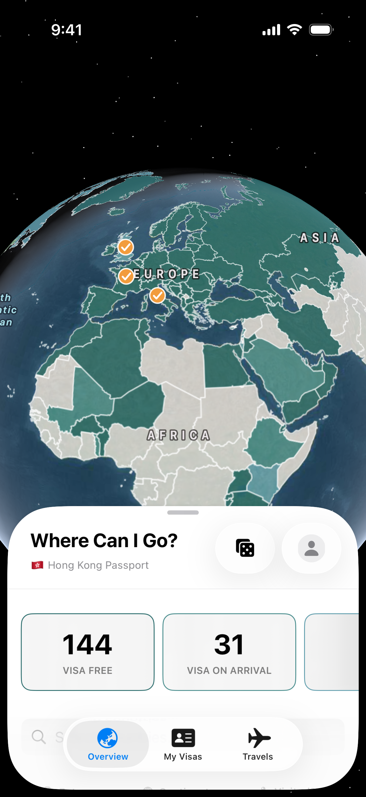
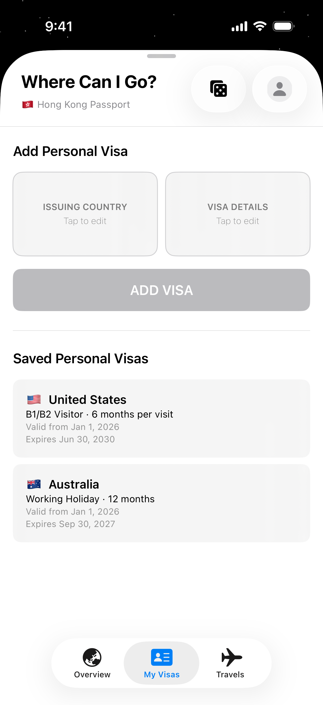
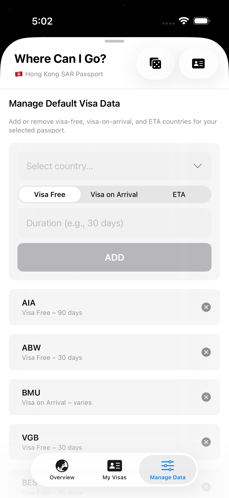

# where-can-i-go | 跟住去邊度

See which countries your passport can enter, keep track of your own visas, and log the places you have been and want to go. Everything stays on your iPhone.

| Main View | My Visas | Manage Data |
|:---:|:---:|:---:|
|  |  |  |

## For Users

### What the app does

- **World map by entry requirement.** Countries are coloured by what your passport needs: visa free, visa on arrival, ETA, visa required, or covered by one of your own visas. Tap a country to see the details, add it to your wishlist, log a visit, add a visa, or search the web for it.
- **Overview.** A searchable list of countries with filters for entry requirement, continent and visited status.
- **My Visas.** Save the visas you hold, with validity dates, notes and photo or PDF attachments. A valid visa updates the map. Schengen visas can cover the whole Schengen area.
- **Travels.**
  - *Been*: log trips with dates, purpose and location. A summary card shows countries, trips, continents and days, and you can share it as a passport-style image.
  - *Wishlist*: plan future trips. When you go, mark the plan as visited and it moves to Been.
  - *Friends*: swap travel cards with friends over AirDrop, Messages or any app, then browse their Been and Wishlist offline. You choose what your card includes in Settings → Sharing: name, photo, Been, Wishlist, and how much detail (dates, length of stay, location, purpose). A friend's card updates when they share again.
- **Random destination.** Tap the dice to pick a country. Long-press it to limit the pick by continent, airline (Cathay Pacific and HK Express for now), or entry requirement.
- **Edit entry policies.** If a bundled rule is out of date, you can change it for your passport, or reset to the bundled data.
- **Backup.** In Settings you can export your data to a JSON file and import it on another device. Import can replace everything or merge in new records only. Profile photo, visa attachments, friends and your sharing identity are optional in the export.
- **Languages.** English, Traditional Chinese and Simplified Chinese.
- **Help and feedback.** Settings has an FAQ, a privacy policy, an About page and Send Feedback (email or GitHub issue).

### Supported passports

Hong Kong SAR (HKG), Macao SAR (MAC), China (CHN) and Taiwan (TWN).

### Requirements

iOS 26.2 or later. iPhone is the main target; iPad works but some layouts still need work.

### Your data

See the full [Privacy Policy](PRIVACY.md).

The app has no account and no server. Your records, profile and attachments are stored in the app's own folder on your device. They only leave the device when you export a backup, share an image, or send a travel card yourself. A travel card holds only what you chose to include. Notes, passport, My Visas and visa attachments stay on your device.

### Important

Entry policies in the app are maintained by hand and can be out of date. Use them for planning only. **Always confirm the current rules with the destination's authorities and your airline before you travel**, especially temporary exemptions and territory-specific arrangements.

## For Contributors

### Getting started

1. Clone the repository:

   ```sh
   git clone https://github.com/marc0cheung/where-can-i-go.git
   ```

2. Open `where-can-i-go-ios/whereCanIGo.xcodeproj` in Xcode 26.2 or later.
3. Select the `whereCanIGo` scheme and run it on a simulator or device. To run on a device, set your own development team under *Signing & Capabilities*.

The project has no third-party dependencies.

### Where things are

```
where-can-i-go-ios/whereCanIGo/
├── Models/       Data types, AppState, backup format
├── Services/     Persistence, bundled data loading, backup import/export
├── Views/        SwiftUI and MapKit views (Sheet/ holds the bottom panel tabs)
└── Resources/    Bundled JSON data and the world GeoJSON
```

Architecture, data formats and design decisions are described in [tech_notes.md](tech_notes.md). Please read it before changing persistence, the backup format or the map.

### Common contributions

- **Fix an entry policy.** Edit `Resources/default_visas_<ISO3>.json` and add the source to the section below.
- **Add a passport.** Add `default_visas_<ISO3>.json`, add the code to `supportedPassportCodes` in `Views/PassportPickerView.swift`, and list the source below.
- **Add an airline.** Add a record to `Resources/airline_destinations.json` and a logo image set with the matching `logoAssetName`. Add the name to `Localizable.xcstrings` if it needs translating.
- **Translations.** All UI strings are in `Localizable.xcstrings`.

### Pull requests

- Open an issue first for larger changes.
- Keep each pull request focused on one change and describe what you tested.
- Add screenshots for UI changes.
- Update this README or `tech_notes.md` when you change data formats or behaviour described there.

## Data Sources

- **Hong Kong (HKG):** [Immigration Department, visa-free access information](https://www.immd.gov.hk/hkt/service/travel_document/visa_free_access.html).
- **China (CHN):** [source summary and disclaimer](where-can-i-go-ios/whereCanIGo/Resources/Source/default_visas_CHN.sources.md).
- **Taiwan (TWN):** [source summary and disclaimer](where-can-i-go-ios/whereCanIGo/Resources/Source/default_visas_TWN.sources.md). Assumes an ordinary passport with a national ID number (household registration).
- **Macao (MAC):** [Identification Services Bureau, travel convenience information](https://www.dsi.gov.mo/en/visa).

Duration remarks are shortened. eVisas that need an application are listed as visa required. If you add another data source, note its licence and add it here.

## Known Issues

- iOS only.
- Some entry policies may be inaccurate or out of date.
- Country borders are simplified for map performance, so small areas may be imprecise.
- The selected country's outline can look thicker in some places than others.
- iPad layouts may have problems.

## Roadmap

- Friends phase 2: exchange cards with someone nearby in one step, and compare your travels with a friend's ([tech_notes.md](tech_notes.md#friends))
- Smoother country borders and better map performance
- Travel journal
- Detect visited countries with location permission
- More than one passport
- iOS 16 support

## License

See [LICENSE](LICENSE).

## Contact

Open an issue on GitHub for questions or ideas, or find us on Instagram at [@wherecanigo_app](https://www.instagram.com/wherecanigo_app/).
